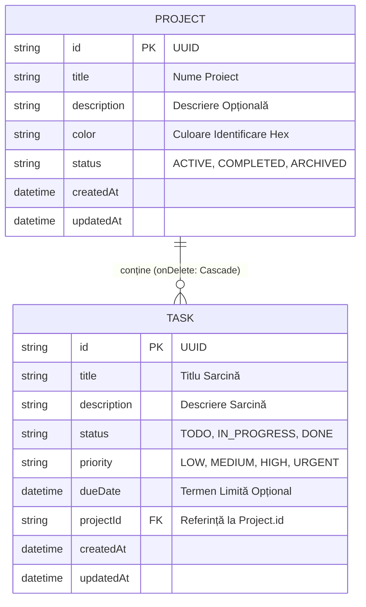
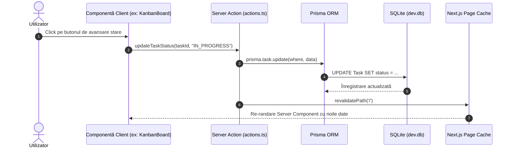

# ⚙️ Documentație Tehnică: TaskSelect Flow Manager

Această documentație prezintă arhitectura software, modelul de date, deciziile de proiectare și specificațiile de implementare pentru aplicația **TaskSelect**, dezvoltată în cadrul ecosistemului **Next.js 16 (App Router)** cu **React 19**, **Tailwind CSS v4** și **Prisma ORM**.

---

## 1. Arhitectura de Ansamblu (High-Level Architecture)

Aplicația implementează modelul arhitectural **Server Components + Server Actions** promovat de Next.js App Router:
- **Server Component Root (`src/app/page.tsx`)**: Efectuează citirea inițială a datelor (`getProjects`, `getTasks`) asincron pe server fără expunerea de rute API suplimentare.
- **Client Component Controller (`DashboardView.tsx`)**: Gestionează starea efemeră din browser (proiectul selectat, termenul de căutare, vizualizarea Kanban vs. Listă, ferestrele modale).
- **Server Actions (`src/app/actions.ts`)**: Funcții asincrone marcate cu `'use server'` care execută mutațiile în baza de date și revalidează cache-ul Next.js prin `revalidatePath('/')`.

```mermaid
graph TD
    subgraph Browser_Client [Browser (Client-Side)]
        DashboardView[DashboardView.tsx: Controller de Stare]
        Sidebar[Sidebar.tsx: Gestiune Proiecte]
        StatsHeader[StatsHeader.tsx: KPI & Filtre]
        KanbanBoard[KanbanBoard.tsx: Bord 3 Coloane]
        TaskTable[TaskTableView.tsx: Vizualizare Tabelară]
        NewTaskModal[NewTaskModal.tsx]
        NewProjModal[NewProjectModal.tsx]

        DashboardView --> Sidebar
        DashboardView --> StatsHeader
        DashboardView --> KanbanBoard
        DashboardView --> TaskTable
        DashboardView --> NewTaskModal
        DashboardView --> NewProjModal
    end

    subgraph NextJS_Server [Next.js 16 Server]
        Page[src/app/page.tsx: Server Component]
        Actions[src/app/actions.ts: Server Actions]
        PrismaClient[src/lib/prisma.ts: Prisma Client Singleton]

        Page -->|Fetch inițial| PrismaClient
        Actions -->|Create / Update / Delete| PrismaClient
        Actions -->|revalidatePath| Page
    end

    subgraph Database_Layer [Database Layer]
        SQLite[(SQLite Database: dev.db)]
        PrismaClient --> SQLite
    end

    Page -->|Propagă projects & tasks| DashboardView
    NewTaskModal -.->|FormData| Actions
    NewProjModal -.->|FormData| Actions
    KanbanBoard -.->|updateTaskStatus| Actions
    Sidebar -.->|deleteProject| Actions
```

---

## 2. Modelul de Date (Prisma Schema)

Fișier: [prisma/schema.prisma](file:///c:/PORTABLE/dev/projects/FirstReact_project_react/NextJS_Tutorial/taskselect/prisma/schema.prisma)

### Diagrama Relațională


### Reguli de Integritate:
- **Ștergere în cascadă (`onDelete: Cascade`)**: La eliminarea unui proiect, toate sarcinile asociate acestuia sunt șterse automat din baza de date, prevenind înregistrările orfane.
- **Valori implicite**:
  - `Project.color` are valoarea implicită `#3b82f6` (Albastru Tailwind).
  - `Task.status` începe cu starea `TODO`.
  - `Task.priority` este setată implicit pe `MEDIUM`.

---

## 3. Ciclul de Viață al Mutațiilor prin Server Actions

Spre deosebire de o arhitectură clasică bazată pe `fetch('/api/...')` și `useEffect`, mutațiile din TaskSelect utilizează Server Actions:



### Server Actions Implementate:
1. **`getProjects()`**: Interoghează lista proiectelor împreună cu numărul de task-uri finalizate și totale.
2. **`createProject(formData)`**: Extrage valorile `title`, `description`, `color` din formular și creează înregistrarea.
3. **`deleteProject(id)`**: Șterge proiectul și revalidează pagina.
4. **`getTasks(projectId?, priority?, search?)`**: Interogare flexibilă cu filtrare direct pe server.
5. **`createTask(formData)`**: Validează câmpurile obligatorii și persistă sarcina în baza de date.
6. **`updateTaskStatus(id, status)`**: Actualizează starea sarcinii (`TODO` -> `IN_PROGRESS` -> `DONE`).
7. **`deleteTask(id)`**: Elimină sarcina selectată.
8. **`seedInitialDataIfEmpty()`**: Populează automat baza de date la prima rulare dacă nu există proiecte.

---

## 4. Sistemul de Design și Stilizare (Tailwind CSS v4)

Aplicația folosește **Tailwind CSS v4** cu o tematică Dark Mode modernă:
- **Fundal General**: `bg-slate-950` (negru-albăstrui profund).
- **Containere și Panouri**: `bg-slate-900` cu borduri subtile `border-slate-800`.
- **Carduri Interactive**: `bg-slate-800/80` cu efecte de tranziție la hover.
- **Accente de Culoare per Prioritate**:
  - `URGENT`: Fundal `bg-rose-500/15`, text `text-rose-400`, bordură `border-rose-500/30`.
  - `HIGH`: Fundal `bg-amber-500/15`, text `text-amber-400`, bordură `border-amber-500/30`.
  - `MEDIUM`: Fundal `bg-blue-500/15`, text `text-blue-400`, bordură `border-blue-500/30`.
  - `LOW`: Fundal `bg-slate-700/50`, text `text-slate-400`, bordură `border-slate-600/40`.

---

## 5. Ghid de Rulare și Verificare Locală

Pentru a porni aplicația pe mașina locală:

```bash
# 1. Navigare în director
cd c:\PORTABLE\dev\projects\FirstReact_project_react\NextJS_Tutorial\taskselect

# 2. Instalare pnpm
pnpm install

# 3. Inițializare Prisma
npx prisma db push

# 4. Rulare dezvoltare
pnpm dev
```
Serverul local va rula pe portul standard: `http://localhost:3000`.
